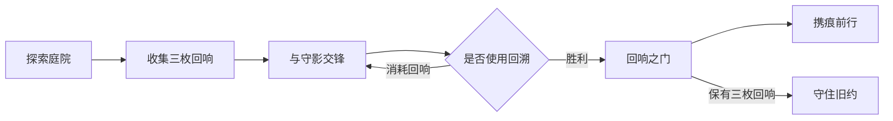

# 《天问》新游戏试作方案

## 当前依据

《宿命篇》实物数据和[首轮事件分析](../reverse-engineering.md)已经取得。用户指定[贴吧帖](https://tieba.baidu.com/p/6534400092)由原作者账号“灵域桃源”提供剧本；当前网络仍未取得正文，因此本轮不能确认章节、角色续作状态或原稿演出顺序。

目前的可玩产物是[《回响之门》规则原型](../../prototype/README.md)，全部新增场景与对白均标为试作内容。原作者剧本内容、从《宿命篇》提取的规则、本次新增设计分别记录，后续取得正文后再核对和替换。

## 第一条可玩流程

试作目标是让“逆转有代价”成为玩家可以感受到的选择。回溯恢复上一轮的气血、灵力与敌人状态，但代价不回滚；保全记忆与降低战斗风险之间形成取舍。这是新设计，不是已核实的原稿机制。

沿用的数据只有李剑灵一级气血 228、灵力 39、御刀术耗灵力 5。新敌人、伤害公式、蓄力节奏、地图与结尾均单独设定；该试作不是原作 ATB 战斗或整个续作的完成版。

## 后续游戏结构

| 系统 | 最小职责 | 当前进展 |
| --- | --- | --- |
| 剧情与任务 | 场景目标、前置条件、选择、状态变更、出口 | 原型用 JSON 场景与状态机验证；原作者章节待取得 |
| 世界探索 | 地图通行、邻接交互、地点转换 | 原型有碰撞、石碑、人物与门 |
| 战斗 | 行动、资源、敌方意图、胜败、任务结果 | 已实现单人离散回合试验；原版 ATB 与公式待验证 |
| 命运与记忆 | 可回溯范围、不可回滚代价、分支解锁 | 原型覆盖两条结尾路线 |
| 存档 | 版本、位置、资源、任务、战斗与结尾状态 | 原子写入、格式校验、存读档回归测试已实现 |
| 内容证据 | 作者原稿位置、原版事件定位、新设计标识 | 原版索引完成首轮，续作原稿位置待补 |

## UE 5.4 目标实现

仓库原有目标仍为 UE 5.4。本机未检测到可用 UE 编辑器，因此本次先提供独立可执行原型，没有声称构建了 UE 游戏工程。

后续将场景 JSON 拆为任务、对话、角色与关卡数据；稳定 ID 与来源定位随数据保留。全局任务/世界状态可由 GameInstance 子系统管理，场景交互通过角色与触发器传递事件；存档由 SaveGame 对象保存。接口设计参照 Epic 的[子系统文档](https://dev.epicgames.com/documentation/en-us/unreal-engine/programming-subsystems-in-unreal-engine)与[存读档文档](https://dev.epicgames.com/documentation/en-us/unreal-engine/saving-and-loading-your-game-in-unreal-engine)。

进入 UE 实现前，先确认：承接哪个结局；原稿章节是否完整；关键角色与世界状态；原版战斗规则中哪些必须保留。第一阶段只替换当前一条小流程的显示和输入层，不把尚未核实的原稿情节扩展成完整章节。
